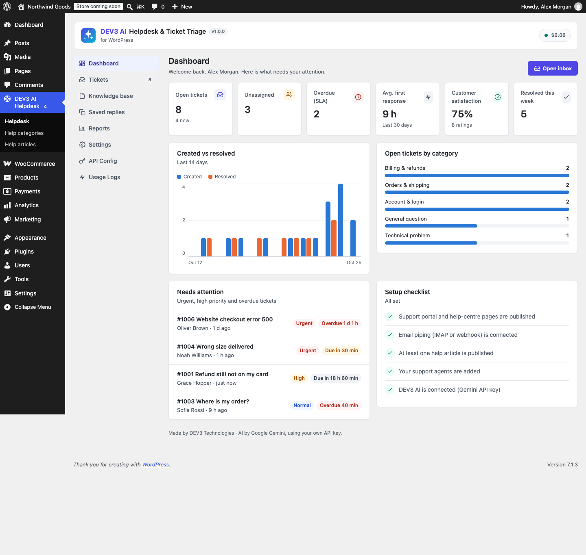

# DEV3 AI Helpdesk & Ticket Triage for WordPress

Support tickets from forms and email, a searchable help centre, and DEV3 AI triage, KB-grounded reply drafts and thread summaries.



## Features

A complete, self-hosted helpdesk for WordPress. Customers open tickets from a support portal, a contact form or by email; your team answers from a fast inbox; a help centre answers the common questions before they become tickets. DEV3 AI (Google AI, your own key) triages new tickets, drafts replies grounded in your knowledge base, summarises long threads and turns solved tickets into help articles. AI only drafts: agents review and send. Everything works without AI.

### Tickets and inbox
* Support portal block + [dev3hd_portal], ticket form block + [dev3hd_ticket_form], My Account → Support with WooCommerce.
* Guests get a private link; "Lost your link?" re-sends links. Honeypot, fill-time check, rate limits, block list.
* Statuses (new, open, waiting on customer, on hold, resolved, closed), priorities, departments, categories, tags.
* Replies, internal notes, saved replies with placeholders, private attachments with signed expiring links.
* Inbox views (open, mine, unassigned, overdue), filters, search in messages, bulk actions, CSV export.

### Email piping
* IMAP polling (SSL, STARTTLS) through background jobs, no PHP imap extension needed, "Check now" with progress.
* Inbound webhook for Mailgun, SendGrid Inbound Parse, Postmark, generic JSON or raw MIME.
* Threading by [#number] and Message-ID, quote stripping, auto-reply and loop protection.

### SLAs, CSAT, reports
* First-response and resolution targets per priority, business hours, clock paused while waiting on the customer, breach alerts.
* Satisfaction ratings after resolution; reports by agent, category, channel and priority.

### Knowledge base
* Help articles with categories, a help centre block + [dev3hd_help_center] with instant search, topics and popular articles, "Was this helpful?" votes and related articles.

### DEV3 AI
* Triage: category, priority, sentiment, language and summary (apply with one click, or opt in to auto-apply).
* Reply drafts grounded in your help articles (embeddings), with cited sources; optional auto-send for confident answers.
* Rewrite (grammar, friendlier, formal, shorter, empathy), thread summaries, article builder from solved tickets, article-gap report.
* Semantic help-centre search with keyword fallback, cost cap, cache and PII masking.

### WooCommerce
* Customer orders panel on every ticket, order number on the form (verified against the email). HPOS compatible.

## Requirements

- WordPress 6.0 or newer (tested up to 6.8)
- PHP 7.4 or newer
- WooCommerce 8.0 or newer (optional integration)
- Optional: your own Google AI API key (from Google AI Studio) to switch on the DEV3 AI features. The rest of the plugin works without one.

## Installation

### From the release zip

1. Download `dev3-ai-helpdesk.zip` from the [latest release](https://github.com/dev3tech/dev3-ai-helpdesk/releases/latest).
2. In WordPress, go to **Plugins → Add New → Upload Plugin**, choose the zip and click **Install Now**.
3. Click **Activate**.

### Build from source

```bash
git clone https://github.com/dev3tech/dev3-ai-helpdesk.git
cd dev3-ai-helpdesk
composer install --no-dev
npm ci
npm run build
```

Then copy the `dev3-ai-helpdesk` folder into `wp-content/plugins/` and activate it.

### Getting started

1. Upload the zip in Plugins → Add New → Upload and activate.
2. Support and Help centre pages are created for you.
3. Open DEV3 AI Helpdesk → Settings to add departments, agents, SLAs and email piping.
4. Optional: add your Google AI API key in API Config.

## FAQ

### Does it work without AI?
Yes. Every helpdesk feature works without a key; AI features stay hidden or disabled.

### Will AI send replies to my customers?
Only if you turn on auto-send. By default DEV3 AI prepares drafts that an agent reviews and sends.

### Do I need the PHP imap extension?
No. The plugin includes its own IMAP client.

## Documentation

The full HTML guide (installation, settings, hooks and FAQ) is in [`docs/index.html`](docs/index.html). Open it in a browser after cloning or downloading the repository.

## Changelog

### 1.0.0
* Initial release.

## Licence

Released under the GNU General Public License v2.0 or later (GPL-2.0-or-later). See [LICENSE](LICENSE).

## More from DEV3

- [DEV3 AI Helpdesk & Ticket Triage for WordPress on the DEV3 Marketplace](https://www.dev3.tech/item/dev3-ai-helpdesk)
- [More WordPress plugins, themes and templates from DEV3](https://www.dev3.tech/marketplace)
